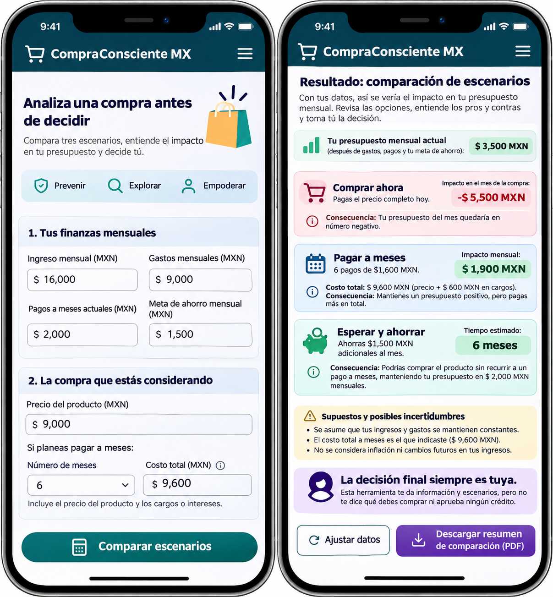
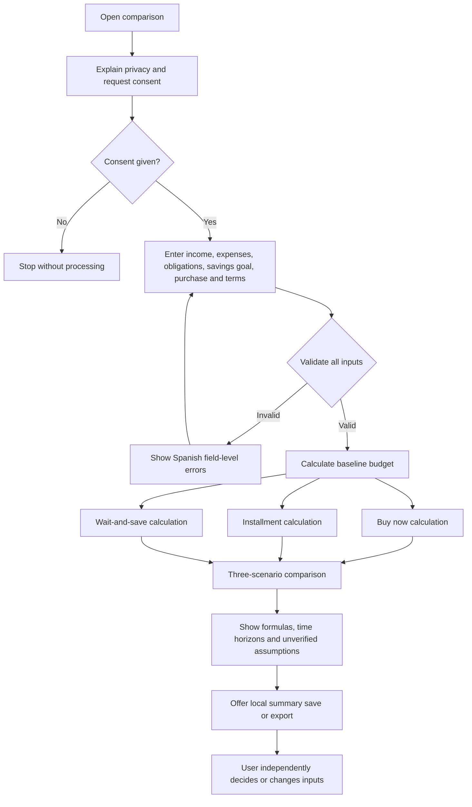
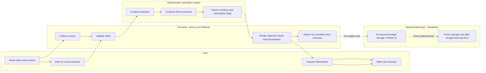

# CompraConsciente MX — Week 12 Core Build Packet

**Course:** Business Bending — Week 12: Extraction + The Core Build  
**Status:** Proposed implementation plan; no application implementation or validation is claimed  
**Source documents:** `docs/CHARTER.md`, `docs/PERSONAS.md`, and the Week 12 Blueprint conditions supplied for this milestone  
**Methodology:** Prevent, Explore, Empower  
**Product language:** All actual product interface copy must be in Spanish; this planning document is in English.

## 1. Problem and exact user

CompraConsciente MX is designed for Spanish-speaking Mexican adults ages 18–29 who are considering a discretionary purchase influenced by advertising, social media, or everyday pressure. A product price or attractive monthly installment can obscure how much money remains after living expenses, existing payment obligations, and existing savings goals. Users need to compare the immediate expense, the recurring commitment, and the delay required to save, without an algorithm telling them what to buy.

**Synthetic test profiles, not customer evidence:** Valeria Hernández (24) earns a regular salary and already has installment payments; Diego Ramírez (22) has irregular freelance income and uncertain savings capacity. Their fictional circumstances help design and test edge cases. They are not interview participants, a representative sample, or proof of demand.

## 2. Measurable success definition

**At the live URL before Week 12 closes**, a visitor can (a) read and affirm a clear consent notice before entering financial inputs; (b) enter and validate fictional or self-provided monthly values; (c) calculate all three scenarios with correct MXN amounts; (d) inspect formulas, total financing cost, time horizons, and uncertain assumptions; (e) see that no scenario is automatically selected; and (f) save or export a non-sensitive comparison summary locally without a backend account. The page must work on a mobile viewport, and the deployed version must reflect a documented fix-and-redeploy cycle.

**North Star:** percentage of completed usability-test sessions where a participant correctly identifies the budget impact of all three scenarios and explains at least one trade-off without being coached or told what to choose. **Proposed target: at least 80%**, with participant count, rubric, and failures disclosed. **Unverified:** no test sessions or comprehension results are claimed. Functional acceptance and comprehension validation are separate.

## 3. Mobile-first generated mockup

**Actual artifact path:** `public/images/compra-consciente-week12-ai-mockup.png` (relative to project root). This is a **genuinely AI-generated mobile-first visual concept**, not a screenshot, functioning prototype, or proof that calculations or download functionality have been implemented. It illustrates fictional Valeria inputs, Spanish interface text, “Comprar ahora”, “Pagar a meses”, and “Esperar y ahorrar”, MXN results, uncertainty labels, and “La decisión final siempre es tuya.” The illustration is not a source of calculation truth: implementation must follow Section 11 and the manually verifiable test vectors in Section 14.

**Suggested UI labels:** “Tu información mensual”, “Comprar ahora”, “Pagar a meses”, “Esperar y ahorrar”, “Supuestos”, “Costo adicional”, “Tú tomas la decisión final”. Consent must be actionable rather than a decorative mockup notice.

## 4. Mermaid flowchart

## 5. Mermaid swimlane

The swimlane depicts responsibilities, not a claim that these components are already operational. No lane authorizes, blocks, or executes a financial transaction.

## 6. Global benchmark

**Benchmark: YNAB (You Need A Budget)**, a budgeting product associated with assigning money to spending and saving categories and planning expenses. This is a relevant conceptual benchmark for budget visibility and intentional allocation, **not** evidence that it provides this precise three-option purchase comparison. **Verification status:** this general benchmark characterization should be checked against current official YNAB documentation before being described as a verified feature-by-feature comparison; no live external audit was performed for this Packet.

**CompraConsciente MX differentiation (proposed, not validated):** one lightweight, Spanish-first, MXN-denominated purchase decision flow for Mexican adults ages 18–29; explicit immediate/recurring/saving time horizons; clear treatment of existing obligations, extra savings contributions, and irregular-income assumptions; no bank connection required. We do not claim superior accuracy, conversion, comprehension, pricing, or a measured improvement over YNAB.

## 7. Three-year vision

In three years, CompraConsciente MX could become a trusted Spanish-language companion for understanding everyday purchase trade-offs in Mexico. If the core comparison proves useful through real testing, the venture could add user-requested accessibility and planning features with privacy-preserving controls. Any expansion would remain conditional on demonstrated need, responsible security, and continued human decision authority.

## 8. Scope cuts for Week 12

**Included:** consent, one validated financial input flow, three deterministic calculations, transparent Spanish explanations, visible assumptions, negative remainders, a user-initiated locally downloaded non-sensitive PDF comparison summary, mobile presentation, tests, and deployment.

**Excluded:** bank integrations, account aggregation, receipt scanning or image analysis, automatic purchases or approvals, credit scores or eligibility, predictive AI financial advice, AI rankings, personalized investment or lending recommendations, affiliate sales, payment collection, email notifications, user profiles, persistent personal budget histories, complex amortization/variable-rate loan models, and decorative extras. Supabase may be provisioned without collecting user financial records. No feature expansion before core testing.

## 9. Architecture and free-stack plan

| Component | Responsibility | Week 12 plan and status |
| --- | --- | --- |
| Next.js / React | Spanish mobile-first form, consent, comparison results | Planned, not built |
| Tailwind CSS | Responsive spacing, legible tables/cards, focus states | Planned, not built |
| TypeScript deterministic module | Validated calculations and assumption flags, independent of UI | Planned, not built |
| GitHub | Versioned repository, meaningful commits, no secrets | Planned, not connected |
| Vercel | Public HTTPS deployment, production verification, redeploy | Planned, no live URL claimed |
| Supabase | Optional future data layer; no personal budget storage needed for MVP | Planned/configurable, no storage/auth claimed |
| Venture-owned domain | Real domain owned by venture, configured with DNS and HTTPS when acquired | **Must be purchased by the venture and connected to Vercel before final Week 12 submission; not acquired or connected** |

**Domain submission gate:** a real venture-owned domain must be purchased, connected to the Vercel production deployment, and checked for working DNS and HTTPS **before the final Week 12 submission**. A free `vercel.app` subdomain alone does not meet this requirement. No purchase or connection is claimed.

Use free tiers where available, subject to current provider limits and domain-registration costs. Keep calculation logic separate from UI components so it can be tested independently.

## 10. Input → logic → output → saved result: privacy-first decision

**Proposed saved-result approach (instructor confirmation pending):** after explicit consent, compute entirely in the browser, without writing entered budgets to Supabase or sending them to an LLM. Present the three results; provide **“Descargar resumen de comparación (PDF)”** as an explicit user-triggered download of a locally generated, non-sensitive PDF summary containing scenario outputs, formulas, assumptions, and a date, but **no raw income, expense, or obligation inputs by default**. The saved result is the downloaded file on the user's device; no claim of cloud persistence. Make the summary optional and explain that downloads may remain on the user's device. Do not persist budgets in cookies, analytics, logs, localStorage, or server databases.

**Important acceptance dependency:** confirm with the instructor that a user-initiated local download meets the Week 12 “saved result” requirement. If server-side persistence is explicitly required, do not silently weaken privacy: obtain a revised storage design and consent, implement Google authentication, user-scoped Supabase RLS, access tests, deletion, and retention rules before collecting any personal user records. An anonymous, aggregate, non-identifying test counter is not a substitute for a required saved result.

## 11. Deterministic calculation specification

**Inputs (MXN unless stated):** `I` net monthly income; `E` monthly expenses; `O` existing monthly payment obligations; `G` existing monthly savings goal; `P` purchase price; `N` number of installments; `T` disclosed **total amount payable** for installments, including all known fees/interest; `S` **additional** monthly amount earmarked for this purchase; optionally `A` existing savings already earmarked for this purchase (default 0). All calculations must show currency and distinguish an assumption from a verified offer.

**Baseline:** `B = I − E − O − G`. The existing savings goal `G` is subtracted **once**. The new purchase-specific savings `S` is separate and never included in `G` unless the user explicitly adjusts their entries.

**Buy now:** `current_month_remainder = B − P`. This is a one-time current-month illustration, not a statement about bank account cash or borrowing capacity. If explicitly using existing earmarked funds `A`, show `out_of_budget_purchase = max(P − A, 0)` and `remainder = B − out_of_budget_purchase`, with a visible explanation of the earmarked-funds assumption; do not silently count savings twice.

**Installments:** require `N` to be a positive whole number and `T` to be a known, nonnegative amount at least `P` for the supported fixed-total model. `monthly_payment = T / N`; `additional_financing_cost = T − P`; `monthly_remainder_during_term = B − monthly_payment`. Use integer centavos for calculations and a documented centavo-rounding/allocation rule so the displayed installment schedule sums exactly to `T`; e.g., assign rounding remainder to the final installment. If `T` is unknown, **do not invent zero fees**: display “Costo total no verificado” and mark the installment comparison incomplete until a total payable is entered. Do not calculate an APR from an unsupported rate model.

**Wait and save:** `remaining_target = max(P − A, 0)`. If `remaining_target = 0`, the target is already funded (`months = 0`); otherwise if `S > 0`, `months = ceil(remaining_target / S)` and `monthly_remainder_while_saving = B − S`. If `S = 0` and a target remains, the saving timeline is **undefined**, not infinity or zero. No future price changes or interest earned are assumed. State that the projected months depend on consistently making the additional contribution. If `S` exceeds available budget, still show the negative remainder and a clear warning about the assumption, not a moral judgment.

**Validation:** reject missing/NaN/infinite, nonnumeric, negative income/expenses/obligations/goals/prices/fees/contributions, `N <= 0`, fractional installment counts, unrealistic magnitudes beyond a documented cap, `T < P` in this fixed-fee model, and `A < 0` or `A > P` if used. Permit **zero income** and **negative calculated remainders** as valid informative outcomes. Prevent overflow; use integer centavos and controlled formatting. Do not use hidden defaults for fee-free financing. Validate in the client and on any future server boundary.

**Uncertainty:** Valeria's salary is a stable-income fictional test assumption; Diego's $9,000 typical income is uncertain. For Diego, repeat the calculation with $6,500 income as a clearly labeled manual stress test, **not** an income prediction. Mark unchanged expenses, fixed income, no price changes, and user-entered offer details as assumptions. Show different time horizons explicitly.

## 12. Blueprint compliance and shadow clause

| Condition | Implementation response |
| --- | --- |
| Specific user and measurable problem | Adults 18–29 in Mexico; measurable scenario comprehension and functional completion |
| Understandable automation | Display baseline, formulas, payment totals, fees, timelines, and plain Spanish descriptions |
| Unverified assumptions labeled | Identify user estimates, uncertain income, missing total payable, constant spending, and future price assumptions |
| Consent before sensitive processing | Show notice and require affirmative consent before collecting financial inputs |
| Human authority | No automatic selection, purchase, approval, rejection, credit judgment, or persuasive “best option” badge |
| Test before expanding | Calculation, privacy, accessibility, comprehension, and redeploy checks precede extra features |
| **Shadow clause** | Never treat a numerical result as an unquestionable verdict that could harm or exclude someone; a negative remainder is a projection to interpret, not proof of financial unsafety or eligibility |

## 13. Five security-floor checks and how to test

1. **No secrets in source code or GitHub.** Use environment variables for any future credentials; scan repository history, commits, configuration, and deployed environment. No Supabase service-role key in the browser.
2. **Google authentication if storing personal user information.** For the no-storage Week 12 design, no login is necessary; inspect network/storage to confirm no user record is saved. If personal storage is added, block release until Google Auth is implemented and tested for unauthenticated access.
3. **User-scoped Row Level Security on user-data tables.** No user-data table is required for the no-storage build. If one is introduced, enable RLS and test separate users cannot read/write each other's rows; deny anonymous access unless deliberately safe.
4. **Input validation on all forms.** Test empty, malformed, negative, zero, huge, fractional, and conflicting amounts; verify visible Spanish errors and no calculation from invalid input.
5. **Fictional, labeled demonstration data only.** Review demo screenshots, seed data, test records, mockup, and video; confirm Valeria and Diego are explicitly synthetic and no real financial data or unsupported claims appear.

**Additional checks:** consent gating, no sensitive logging or analytics, safe download behavior, accessible controls, HTTPS, and no banking passwords or purchase-execution endpoints.

## 14. Testing plan — all tests pending

### Manually verifiable persona calculation tests

| Case | Inputs | Expected outputs |
| --- | --- | --- |
| Valeria baseline | I=16,000; E=9,000; O=2,000; G=1,500 | B=3,500 MXN |
| Valeria buy now | P=9,000 | Current-month remainder = −5,500 |
| Valeria installments | N=6; T=9,600 | 1,600/month; fee=600; monthly remainder=1,900 |
| Valeria save | A=0; S=1,500 | 6 months; monthly remainder=2,000 |
| Diego typical baseline | I=9,000; E=6,500; O=500; G=500 | B=1,500 |
| Diego lower-income baseline | I=6,500; same expenses/obligations/goal | B=−1,000 |
| Diego buy now | P=6,000 | Typical remainder=−4,500; lower-income remainder=−7,000 |
| Diego installments | N=6; T=6,000, fictional no-fee terms | 1,000/month; typical remainder=500; lower-income remainder=−2,000 |
| Diego save | A=0; S=750 | 8 months; typical remainder=750; lower-income remainder=−1,750 |

### Boundary and security tests

- Missing consent: no financial form processing or saved result.
- Missing/invalid income, purchase price, total payable, and installment count: show field errors, no bogus results.
- Zero additional savings with a positive target: show no timeline; fully funded target: zero months.
- Negative projected remainder: preserve the negative sign and explain its meaning without calling the user unsafe.
- Total payable unknown: show an incomplete installment result, not a fabricated zero-interest offer.
- Extreme and decimal inputs: confirm centavo rounding, numeric bounds, and no overflow.
- Privacy: inspect browser network requests, storage, downloads, console logs, Git history, and Supabase tables for financial input leakage.
- Mobile usability: test narrow Android/iPhone viewport, keyboard navigation, focus indicators, contrast, readable Spanish labels, and long numbers.
- **Mechanical fix cycle:** record a failing test with screenshot or log → make a focused fix → commit → redeploy on Vercel → rerun the same test on the live URL → preserve before/after evidence. No cycle is claimed complete.
- **Later synthetic persona walkthrough:** simulate Valeria and Diego step by step, document confusion and changes. Clearly label simulation; follow with real-user comprehension testing before claiming validation.

**Proposed comprehension rubric:** each participant must correctly identify the budget impact of all three scenarios and explain at least one meaningful trade-off without coaching; count only sessions meeting the full definition. Report `passed / total` and any dropouts; 80% is an unverified goal, not an achieved result.

## 15. Implementation milestones and acceptance criteria

1. **Documentation and design:** review Charter, Personas, Packet, and actual mockup path; record instructor acceptance of the local-download saved-result interpretation.
2. **Repository and baseline:** initialize Next.js/TypeScript/Tailwind, `.gitignore`, example environment file, and GitHub repository without secrets.
3. **Calculation engine:** implement one deterministic three-scenario module with centavo-safe arithmetic, explicit unknown-total handling, and automated/manual test vectors.
4. **Spanish mobile UI:** build consent gate, validated input form, side-by-side comparison, assumption disclosures, and no recommendation/approval button.
5. **Saved result:** implement user-initiated local download of a non-sensitive summary and verify it can be reopened; no cloud budget persistence.
6. **Deploy and repair:** publish on Vercel, verify public HTTPS URL, reproduce at least one meaningful defect, fix it, redeploy, and retest.
7. **Evidence and handoff:** document tests and unresolved issues, record synthetic walkthrough, prepare live URL and GitHub link, and purchase and connect the real venture-owned domain before final Week 12 submission, recording completion **only if actually done**.

**Git history target:** at least **five meaningful commits**, such as `docs: define packet and scope`, `feat: implement validated calculation engine`, `feat: build Spanish comparison UI`, `feat: add privacy-first summary export`, and `test: fix calculation edge case and redeploy`. These are proposed commit subjects, **not existing commits**.

**Core acceptance checklist:** [ ] Consent gate works; [ ] all fields validate; [ ] all three formulas match hand calculations; [ ] unknown fees remain unverified; [ ] negative results are visible; [ ] Spanish copy explains assumptions and time horizons; [ ] user remains decision-maker; [ ] local saved result works; [ ] no budgets persist; [ ] mobile layout works; [ ] live URL verified; [ ] documented fix-and-redeploy; [ ] five meaningful commits; [ ] five security checks pass; [ ] usability results accurately reported; [ ] real venture-owned domain purchased, connected to Vercel, and verified before final submission.

## 16. Evidence integrity and open decisions

**Completed for this planning stage:** Charter and Personas were approved as working documents; this Packet and the mockup are proposed artifacts. **Not completed or claimed:** deployed app, GitHub commits, Google authentication, Supabase RLS, purchased domain, user interviews, comprehension measurements, tests, or team/instructor approval of the Packet.

**Open decisions:** (1) confirm that a locally downloaded, non-sensitive summary meets the course's saved-result criterion; (2) verify the approved AI-generated mockup is correctly linked and legible in the Packet; (3) purchase and connect the real venture-owned domain to Vercel before final Week 12 submission. Do not misrepresent these as resolved.
