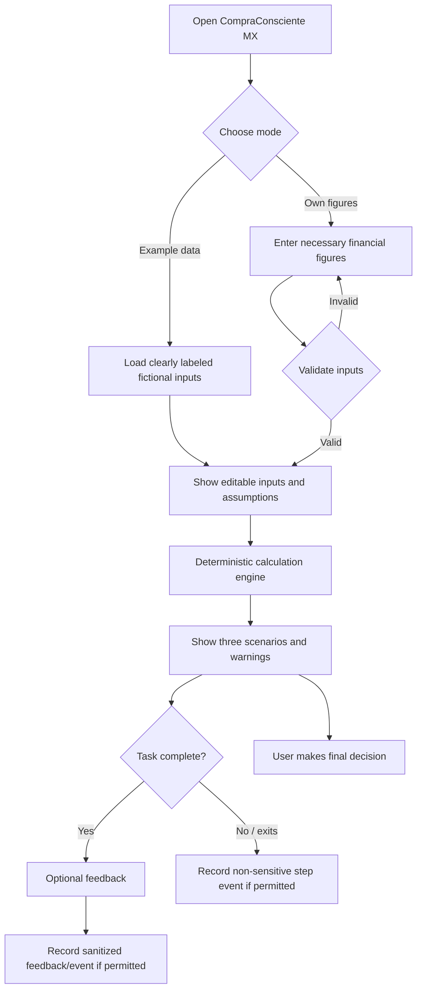
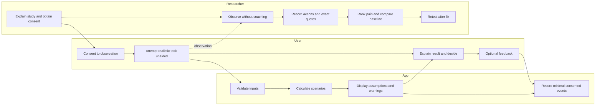

# CompraConsciente MX — Week 13 Packet
**Role:** ADVERSARY | **Milestone:** Quick Compare + Feedback | **Status:** Pre-build proposal, not tested

## 1. Problem and exact user
CompraConsciente MX currently asks users to enter financial details before comparing buying now, paying in installments, or waiting and saving. My adversary hypothesis is that the time and effort needed to reach the first useful result may cause abandonment. We must test that hypothesis rather than assume it is true.

**Primary user:** Mexican young adults approximately 20–30 who shop online, manage a limited or variable monthly budget, and want to evaluate a nonessential purchase without connecting a bank account. Valeria (24, salaried) and Diego (22, irregular income) remain **fictional test personas**, not evidence of real demand.

**Job to be done:** Understand the tradeoffs of a specific purchase quickly enough to make an independent decision. The real alternatives are a calculator, banking app, spreadsheet, or doing the math mentally.

## 2. Success before the module closes
- Preserve the existing deterministic MXN calculation engine and its tests.
- Ship a clearly labeled **example-data mode** and a shorter path to the first comparison, while retaining required financial inputs and visible assumptions. Any reduced-input calculation must explicitly disclose its limitations; never invent missing income, expense, or debt data.
- Add a privacy-minimizing feedback/event mechanism that records only task events (e.g., example_started, form_started, comparison_viewed, feedback_submitted) and timestamps or durations, without salary, expenses, names, account details, free-text financial details, or persistent identifiers. If feedback is free text, warn against entering personal data and validate length.
- Conduct **five observed real-user sessions**, at least **three strangers**, with consent. Record participant role, recruitment source, task, actions, exact consented quotes, time, errors, and alternative workflow. Do not invent sessions or outcomes.
- Rank the **three worst observed pains**, fix the #1 pain, redeploy, and collect before/after evidence. Obtain one independent return signal (repeat use or a voluntary follow-up message); an interview promise alone does not count.
- Run mechanical tests, identify and fix at least one genuine bug, complete a synthetic persona test, and preserve evidence of at least five commits and two deployments. Use the real domain as the URL of record.

**Proposed evaluation metrics (not results):** task completion without coaching; median time to first meaningful comparison; abandonment step; calculation errors; clarity explained in user's own words; comparison with calculator/bank-app baseline; voluntary return. Do not claim a 10:1 advantage without comparable baseline measurements.

## 3. Image-generated mockup
**Proposed asset:** `public/images/compra-consciente-week13-mockup.png` (save the separately generated mockup here).

Three mobile screens in Spanish: (1) welcome with “Comparar una compra” and “Probar con datos de ejemplo”; (2) results for comprar ahora / pagar a meses / esperar y ahorrar, visible assumptions and “La decisión final es tuya”; (3) brief optional feedback form. The mockup is a **design concept, not a screenshot of a working feature**. Figures shown are illustrative, not verified user calculations.

## 4. Mermaid feature flowchart

## 5. Mermaid swimlane (user, application, researcher)

## 6. Global benchmark and Mexico translation
**MoneyHelper (UK):** Free budgeting guidance and tools demonstrate the value of clear explanations; CompraConsciente MX narrows the task to a single purchase in Mexican pesos and installment scenarios. **YNAB (US):** Ongoing budgeting demonstrates a habit-building alternative; our week-13 scope avoids subscription-style comprehensive tracking and does not require bank sync. **CONDUSEF (Mexico):** Existing public financial education and budgeting resources establish a local baseline; our hypothesis is that a short purchase-specific comparison is easier at the moment of decision. These are benchmarks, **not proof of superiority**. Differences in financial infrastructure, user trust, and installment products require testing with Mexican users.

## 7. Three-year view (three sentences)
If the quick-comparison experience proves valuable, CompraConsciente MX could evolve into an optional, understandable financial planning companion for Mexican shoppers. Users could choose whether to keep local records and track savings goals without surrendering decision-making control. Any bank connectivity would require separate demand validation, feasibility review, explicit granular consent, and stronger security before development.

## 8. Scope cuts
**Build now:** example mode, shorter first-result path, transparent comparison, privacy-safe task events, optional feedback, tests and before/after evidence.

**Not building now:** bank/Wallet integration, transaction import, financial account login, investment advice, paid subscriptions, automatic purchasing, predictive credit decisions, server storage of financial profiles, or unverified AI-generated financial calculations. AI may help draft copy but **not calculate budgets**. If analytics cannot be made privacy-safe, use a consented researcher observation log rather than silently collecting sensitive data.

## 9. Architecture and stack
| Component | Technology | Purpose / safeguard |
|---|---|---|
| Interface | Existing Next.js + React + TypeScript | Mobile-first Spanish UI; accessible forms |
| Financial engine | Existing deterministic TypeScript logic | Integer-centavo arithmetic; no LLM for calculations |
| Validation | Client and server validation where applicable | Numeric bounds, nonnegative values, lengths, explicit assumptions |
| Feedback | Minimal opt-in event log; choose storage only after privacy review | No financial figures, personal IDs, or sensitive free text |
| Tests | Existing test runner plus targeted UI/manual tests | Regression, error handling, comparison accuracy |
| Hosting | GitHub + Vercel + existing real domain | Two documented deployments; no secrets in repo |
| Documentation | Markdown, Mermaid, screenshots, consented session notes | Auditable evidence, no fabricated findings |

**Security floor:** no secrets in repository; if personal information is stored, add authenticated access and user-specific authorization/RLS for Supabase tables; validate every input; use fictional labeled demo data; minimize or avoid collecting sensitive information. Consent to a study is separate from permission to collect app analytics. Never promise zero risk.

## 10. Test plan and evidence
**Mechanical pass:** run existing tests; verify calculation consistency for known Valeria/Diego fictional inputs, invalid/blank/negative numbers, large values, mobile layout, example-data labeling, privacy controls and feedback validation. Record a genuine bug, patch, rerun and redeploy; do not invent a bug for the report.

**Synthetic persona pass:** use a fresh chat with a clearly fictional Mexican young adult shopper who is impatient, unfamiliar with budgeting apps and wary of sharing financial information. Show actual screenshots sequentially; record confusion, fix the worst issue, and label this as Layer 1 rather than real-user evidence.

**Real-user Layer 2:** recruit five target users, three strangers minimum. Obtain permission before observing or quoting. Give each an uncoached purchase task and compare with the same task using a calculator or existing bank workflow (order counterbalanced if feasible). Measure time, completion, abandonment, misinterpretation and observed behavior; capture exact consented quotes and role only. Rank top three pains by core-task harm. Fix #1 and collect a comparable post-fix observation. Request an optional independent return signal; do not pressure participants.

**Evidence files to maintain:** `docs/DECISIONS.md`, consented anonymized session log, issue ranking, before/after screenshots and metrics, test output, commit hashes, deploy URLs/timestamps, persona log and demo recording. No real financial data in demos, screenshots or seed files.

## 11. Blueprint alignment and open decisions
This plan addresses the expanded team's **provisional** Blueprint: condition 2 (uncoached observation), condition 3 (rank and fix actual #1 pain), condition 6 (no unsupported 10:1 claim), and the shadow clause (privacy and honest financial guidance). The Blueprint is not yet ratified and its USER role, live votes and findings remain outstanding. **Adversary's testable bet:** reducing time to the first trustworthy comparison matters more than adding financial tracking features. Actual five-user findings may overturn that bet.

## 12. Implementation handoff (after Packet is committed)
1. Commit this packet and mockup before coding.
2. Inspect current files/tests and write acceptance criteria for example mode, quick comparison, and event logging.
3. Implement one small feature per commit, preserving the existing financial engine.
4. Deploy baseline and improved versions; record real domain and evidence.
5. Test with mechanical and synthetic passes, then five real participants; fix the top observed pain and redeploy.
6. End each session by updating `docs/DECISIONS.md` with decisions and the next first move, then commit and push.
